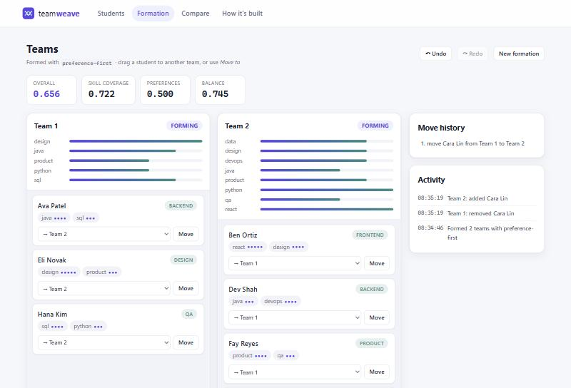
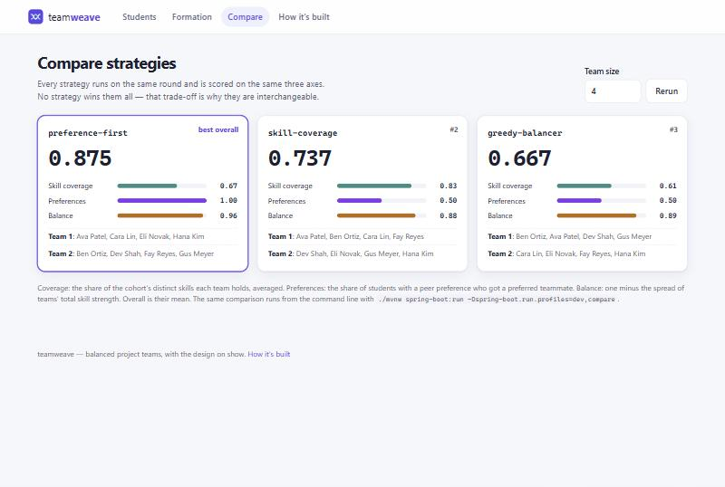
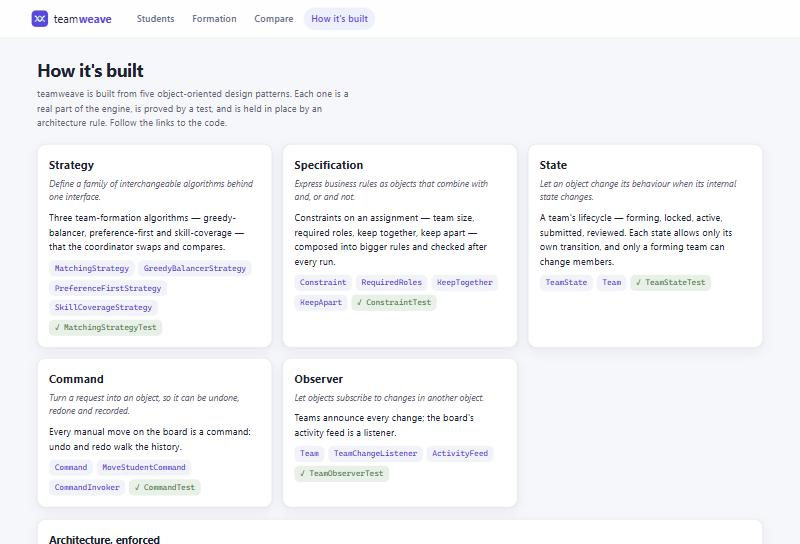
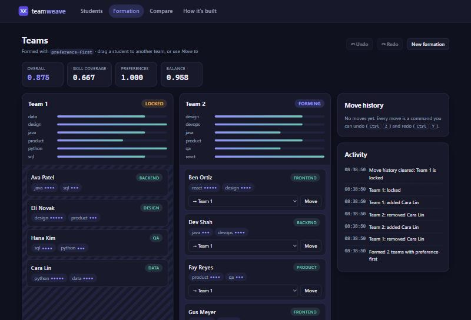

<div align="center">

# teamweave

### Balanced project teams, with the design on show.

teamweave forms project teams from students' skills, availability and preferences, lets a
coordinator adjust them by hand with full undo, and follows each team through its lifecycle.
Its matching engine is built from five object-oriented design patterns — and the app shows you
exactly where each one lives.

[](https://github.com/ManvGit17/team-weave/actions/workflows/ci.yml)
[](https://github.com/ManvGit17/team-weave/releases)




</div>

## Why this exists

Every project course has to split students into teams. Done by hand it's slow and uneven; done by
luck it ignores who can do what and who works well together. teamweave proposes balanced teams,
**scores** them, **explains** every placement, and keeps the coordinator in charge: drag a student
somewhere else, undo it, lock a team once it's settled.

It's also a working tour of object-oriented design. The algorithms, the rules, the lifecycle, the
edits and the notifications are each a classic pattern — tested, enforced by architecture rules,
and linked from an in-app **How it's built** page to the exact code.

## The design, in five patterns

| Pattern | What it does in teamweave |
| :-- | :-- |
| **Strategy** | Three interchangeable matchers — greedy-balancer, preference-first, skill-coverage — that you can swap and compare. |
| **Specification** | Rules that compose with and / or / not: team size, required roles, keep two people together or apart. |
| **State** | A team's lifecycle: forming → locked → active → submitted → reviewed. Only a forming team can change members. |
| **Command** | Every manual move is a command, so undo and redo (<kbd>Ctrl</kbd>+<kbd>Z</kbd> / <kbd>Ctrl</kbd>+<kbd>Y</kbd>) just work. |
| **Observer** | Teams announce every change; the board's activity feed listens. |

Each pattern is mapped to its classes and its test in [`docs/engine.md`](docs/engine.md).

<table>
<tr>
<td width="50%"></td>
<td width="50%"></td>
</tr>
<tr>
<td><b>Compare</b> — every strategy on the same students, side by side.</td>
<td><b>How it's built</b> — each pattern, linked to its code and test.</td>
</tr>
<tr>
<td colspan="2"></td>
</tr>
<tr>
<td colspan="2"><b>State, visibly</b> — a locked team can't gain or lose members; the feed records every step. Dark mode follows your system.</td>
</tr>
</table>

## Quick start

Needs Docker (for PostgreSQL) and JDK 17 or newer.

```bash
docker compose up -d
./mvnw spring-boot:run -Dspring-boot.run.profiles=dev
```

Open <http://localhost:8080>. The `dev` profile seeds a sample cohort of eight students.

1. **Formation** — pick a team size and a strategy, optionally add constraints, and form teams.
2. **Adjust** — drag students between teams (or use *Move to*); undo and redo freely. Scores and
   constraint checks update as you go.
3. **Lifecycle** — lock a team when it's settled, then activate, submit and review it.
4. **Compare** — see every strategy's result on the same students.
5. **How it's built** — the patterns, the architecture rules and a class diagram generated from
   the code.

## Measured, not claimed

On the seeded cohort, in teams of four
(`./mvnw spring-boot:run -Dspring-boot.run.profiles=dev,compare`):

| Strategy | Overall | Skill coverage | Preferences | Balance |
| :-- | --: | --: | --: | --: |
| preference-first | 0.875 | 0.667 | 1.000 | 0.958 |
| skill-coverage | 0.737 | 0.833 | 0.500 | 0.877 |
| greedy-balancer | 0.667 | 0.611 | 0.500 | 0.889 |

No strategy wins every axis, which is the point of making them interchangeable. The comparison
also caught a real bug in preference-first along the way; the story is in
[`docs/engine.md`](docs/engine.md#comparing-them).

## How it's built

```
io.teamweave
├── web             controllers and Thymeleaf views
├── application     services, the session-scoped formation board, the activity feed
├── domain          student · team (State, Observer) · constraint (Specification)
│                   matching (Strategy) · command (Command) · formation (scoring)
└── infrastructure  Spring Data repositories
```

- **Architecture tests** (ArchUnit) enforce the layering and keep the domain free of Spring.
- **A class diagram generated from the compiled code** lives in
  [`docs/diagrams/domain-model.md`](docs/diagrams/domain-model.md); the build fails if it goes stale.
- **PostgreSQL with Flyway** migrations; JPA only validates against the schema, so they can't drift.

More in [`docs/analysis.md`](docs/analysis.md) (use cases, domain model, sequence diagrams),
[`docs/engine.md`](docs/engine.md) and [`docs/roadmap.md`](docs/roadmap.md).

## Tests

```bash
docker compose up -d
./mvnw verify
```

Unit tests for every pattern, architecture rules, a diagram-drift check, service tests against
PostgreSQL, and end-to-end tests that drive the real pages and session. CI runs the same on every
push.

## Contributing

Issues and pull requests are welcome — see [CONTRIBUTING.md](CONTRIBUTING.md) and the
[good first issues](docs/good-first-issues.md).

## License

[Apache-2.0](LICENSE).
