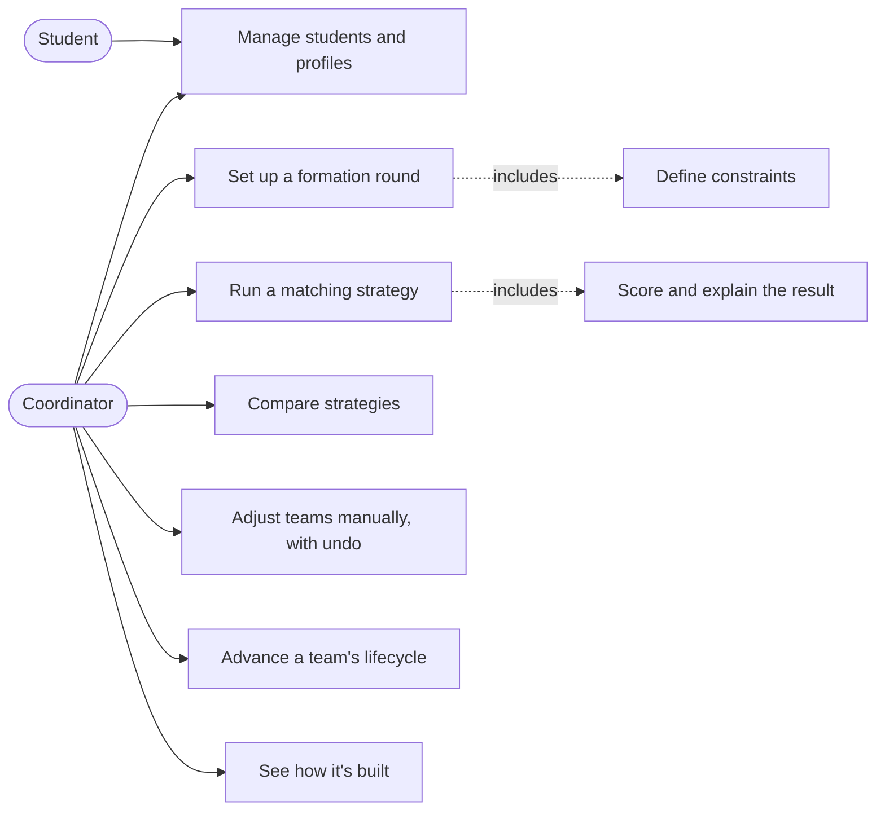
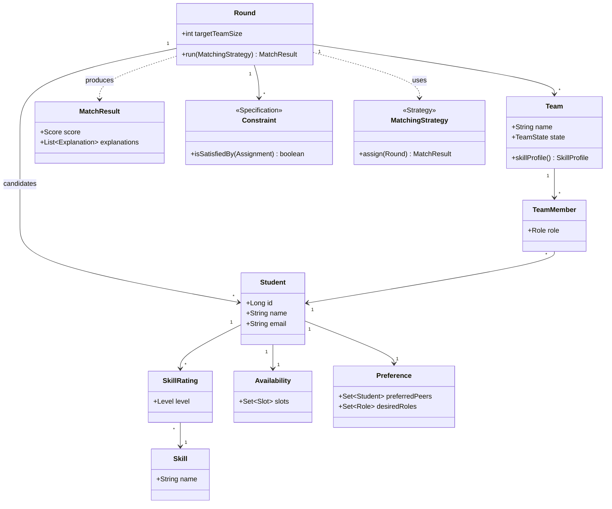
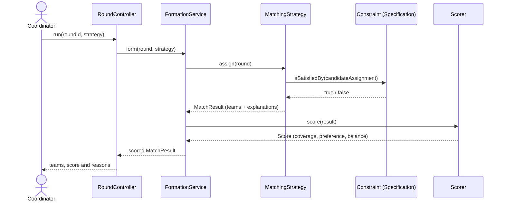
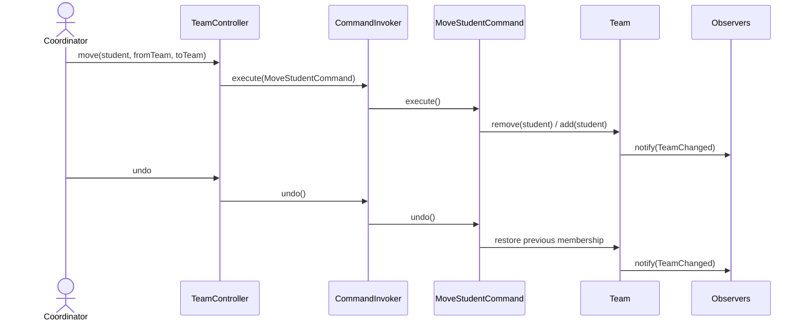

# teamweave — analysis

**teamweave** forms balanced project teams from students' skills, availability and preferences, and
follows each team through its lifecycle. It grows from a small Spring Boot MVC app that managed a
list of students into an engine whose **design is the product**: the matching logic, the
constraints, the lifecycle and the edit history are each a well-known object-oriented pattern, made
visible in the app itself.

## The problem

Every project course has to put students into teams. Done by hand it's slow and uneven; done by luck
it ignores skills, availability and who works well together. A good assignment should balance skills
across teams, cover the roles each team needs, respect reasonable preferences, and be explainable —
you should be able to see *why* a student landed where they did, and adjust it.

## Actors

- **Coordinator** — sets up a round, runs matching strategies, compares results, makes manual
  adjustments, and advances teams through their lifecycle.
- **Student** — has a profile: skills (with levels), availability, interests, and preferences
  (peers they'd like to work with, roles they want).

## Use cases

1. **Manage students and profiles** — add students; record skills and levels, availability,
   interests, and preferences.
2. **Set up a formation round** — choose the students, the target team size, and the constraints.
3. **Run a matching strategy** — produce an assignment of students to teams, scored and explained.
4. **Compare strategies** — run several strategies over the same round and compare their scores
   side by side.
5. **Adjust teams manually** — move a student between teams; every change is undoable and redoable.
6. **Advance a team's lifecycle** — move a team through valid states only (forming → locked →
   active → submitted → reviewed).
7. **See how it's built** — an in-app page that shows where each design pattern lives, with links to
   the source and a class diagram generated from the code.

## Domain model

## Key interactions

### Running a strategy

### A manual move, with undo

## Patterns, and where they live

| Pattern | Role in the domain |
| :-- | :-- |
| **Strategy** | Interchangeable matching algorithms (greedy balancer, preference-first, skill-coverage) behind one `MatchingStrategy` interface. |
| **Specification** | Composable constraints (`isSatisfiedBy`): team size, required roles, keep-together, keep-apart — combined with and/or/not. |
| **State** | A team's lifecycle; only valid transitions are allowed. |
| **Command** | Manual adjustments as commands with undo/redo; every change recorded. |
| **Observer** | Notifications when a team changes. |

These are not decoration: each is exercised by a unit test, enforced by architecture tests, and
shown on the in-app "How it's built" page with links to the code.
